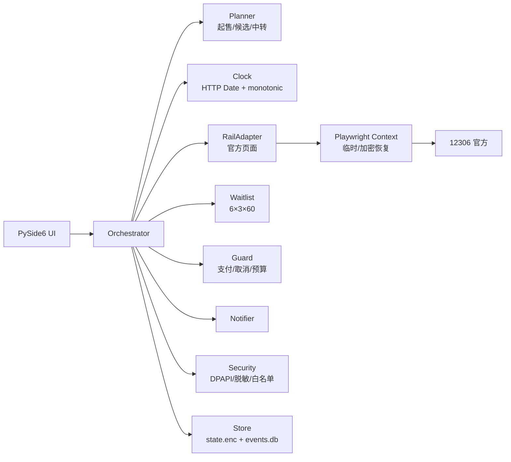

# 04 · 自研安全架构

> 原则：**参考算法，不复制代码；数据安全先于功能。**
> 推荐栈：Python 3.12 + PySide6 + Playwright（系统 Edge/自带 Chromium）+ SQLite（仅非敏感事件）+ Windows DPAPI。

## 1. 设计目标

| 目标 | 做法 |
|---|---|
| 账号凭证不泄露 | 扫码登录；Cookie 默认只存内存；持久化必须 DPAPI |
| 身份证/手机号不落盘 | 从官方账号读取，内存使用后清零；本地只存姓名/类型 |
| 数据不出本机 | 网络白名单 `*.12306.cn`；无遥测/第三方 IP/CDN |
| 不被反检测拖下水 | 不注入 `navigator.webdriver`/`cdc_`；不做指纹伪造 |
| 不重复下单 | 幂等键 + 未支付订单检查 + 订单回读 |
| 不锁号 | 单账号、低频、取消预算、遇验证码即停 |
| 可审计 | 事件日志（无 PII）+ 诊断导出 + 安全自检 |

## 2. 技术选型

| 层 | 选择 | 理由 |
|---|---|---|
| GUI | **PySide6（Qt 6）** | 原生 Windows 体验；比 Electron 少一个 Chromium/Node 攻击面；LGPL 可合规 |
| 浏览器 | **Playwright + 系统 Edge 或自带 Chromium** | 真实浏览器；可拦截请求做白名单；不依赖 CDP 注入 |
| 时钟 | `httpx` + 标准库 `time.monotonic` | HTTP Date 多采样；单调时钟不受系统改时间影响 |
| 配置 | Pydantic v2 + YAML | 类型校验；密钥走 DPAPI/环境变量 |
| 存储 | SQLite（事件/任务元数据）+ DPAPI 加密 JSON（敏感状态） | 避免把姓名/订单写进明文 DB |
| 通知 | 桌面 + webhook/ntfy/ServerChan/Telegram | 默认只发状态/截止，不发 PII |
| 打包 | PyInstaller one-folder | 可审计；不做自动更新 |
| 测试 | pytest + pytest-playwright + respx | 单元/契约/本地页面集成 |

**不选**：Electron（体积/攻击面）、Selenium（驱动下载/反检测生态）、纯 HTTP 逆向（签名/风控/维护成本）。

## 3. 架构



**关键**：浏览器上下文默认**临时**（`browser.new_context()`），不指定 `user_data_dir`，不写 `storage_state` 文件。退出即销毁 Cookie。

## 4. 模块

```text
railpilot/
├─ app/                 # PySide6 窗口/面板
├─ core/
│  ├─ orchestrator.py   # 任务生命周期/状态机
│  ├─ planner.py        # 起售时间/候选排序/中转
│  ├─ clock.py          # 校时
│  ├─ waitlist.py       # 候补组合
│  ├─ guard.py          # 支付/取消预算
│  └─ explain.py        # 事件分类/下一步
├─ rail/
│  ├─ adapter.py        # 官方页面接口（查询/预填/提交/回读）
│  ├─ selectors.py      # 选择器集中管理
│  └─ mock/             # 本地 HTML 克隆页（测试）
├─ security/
│  ├─ dpapi.py          # CryptProtectData/CryptUnprotectData
│  ├─ redact.py         # 日志/截图脱敏
│  ├─ allowlist.py      # 只允许 *.12306.cn
│  └─ wipe.py           # 内存/临时文件清理
├─ store/
│  ├─ state.py          # DPAPI 加密 JSON
│  └─ events.py         # SQLite 非敏感事件
└─ notify/
   └─ channels.py       # 桌面/webhook/ntfy/ServerChan/Telegram
```

### 4.1 `rail/adapter.py`

只做四件事：
- `query(date, from, to)`：低频查询余票。
- `prefill(task)`：打开官方预填页/检查预填状态。
- `submit(candidate)`：在官方页面点提交；返回 `success/queued/sold_out/unknown/risk/login_expired`。
- `read_orders()`：读官方订单列表/未支付订单。

**不实现**：登录接口逆向、验证码识别、设备指纹、代理、CDN。

### 4.2 `core/clock.py`

```python
def calibrate(url: str, samples: int = 5) -> int:
    best = None
    for _ in range(samples):
        t0 = time.monotonic()
        r = httpx.head(url, timeout=5, follow_redirects=True)
        t1 = time.monotonic()
        server = parse_http_date(r.headers["Date"])  # 秒级
        rtt = t1 - t0
        if best is None or rtt < best.rtt:
            best = (server, rtt)
    offset = best.server + best.rtt / 2 - time.time()
    return int(offset * 1000)
```

- HTTP Date 只有秒级精度；目标偏移稳定 ≤1s，不承诺毫秒级。若未来找到官方毫秒级时间源，再收紧。
- 倒计时用 `time.monotonic()` + offset；T-10m/T-2m/T-10s 复校。
- 校时只请求 `https://www.12306.cn`/`https://kyfw.12306.cn`。

### 4.3 `core/waitlist.py`

输入：日期（≤3）、车次/席别（≤60 组合）、乘客（≤19）、截止时间、是否接受新增列车。

算法：
1. 展开 `日期 × 车次 × 席别`，过滤不可行组合（到达太晚、换乘 <30 分钟、席别不接受）。
2. 按用户优先级 + 历史可用性排序。
3. 拆成 ≤6 单；每单 ≤3 日期、≤60 组合、≤19 人。
4. 多人同行尽量同单；老人/儿童优先下铺。
5. 默认只生成计划/打开官方页面，用户确认提交。

### 4.4 `core/guard.py`

- 未支付订单：读官方订单，跟踪 `pay_deadline`；T-10/5/2 分钟提醒。
- 取消预算：本地记 `manual_cancels_today`；≥2 硬停；跨日 00:00（Asia/Shanghai）重置。
- 一账号一单：发现未支付订单，拒绝新提交。
- Kill switch：`Ctrl+Alt+Q`/按钮 1 秒内停止所有任务、关闭浏览器上下文。

### 4.5 `security/dpapi.py`

```python
# 伪代码：Windows 当前用户绑定
blob = CryptProtectData(data, description, None, None, None, 0)
plain = CryptUnprotectData(blob, None, None, None, None, 0)
```

- 只用用户作用域（不要 `CRYPTPROTECT_LOCAL_MACHINE`）。
- 存储格式：`v1:` + base64(blob)。
- 文件默认放 `E:\RailPilot\data\`（可用 `RAILPILOT_DATA_DIR` 覆盖），用 `icacls` 只给当前用户。
- 解密失败：不要回退明文；提示“换用户/重装”并停止。

### 4.6 `security/allowlist.py`

```python
ALLOWED = (".12306.cn",)
def allowed(host: str) -> bool:
    return host == "12306.cn" or host.endswith(ALLOWED)
```

- Playwright `context.route("**/*", handler)`：非白名单请求 `abort()`，记录 `BLOCKED_HOST`（不含 URL 参数）。
- 只允许 HTTPS；`http://` 直接 block。
- 不请求第三方 IP/WHOIS/遥测/CDN。

### 4.7 `security/redact.py`

- 正则：身份证 18 位、手机号 11 位、`Cookie:` 整行、`tk/uamtk/RAIL_DEVICEID`、订单号。
- 日志 formatter 统一脱敏；不记录请求/响应体。
- 截图：只截订单区域；姓名/证件号打码；默认不保存。

## 5. 会话策略（关键）

| 模式 | Cookie 位置 | 便利性 | 安全 |
|---|---|---|---|
| **默认：内存会话** | Playwright context 内存 | 每次启动扫码 | 最高；退出即失 |
| 可选：DPAPI 加密恢复 | `state.enc`（DPAPI） | 启动免扫码 | 高；同用户可解密 |
| 禁止：明文文件 | `*.json`/`storage_state` | 高 | 低；泄露即盗号 |

**实现**：
- 默认 `browser.new_context()`，不设 `user_data_dir`，不 `storage_state` 文件。
- 可选“记住登录”：`context.storage_state()` 返回 dict → DPAPI 加密 → `state.enc`；启动时解密为 dict → `new_context(storage_state=dict)`；不落明文临时文件。
- 退出：`context.close()`、`browser.close()`、`state.enc` 若存在则按用户选择删除/保留。
- 支付页：复用同一 context；不创建第二个持久化 profile。

## 6. 数据模型

**敏感状态**：`state.enc`（DPAPI JSON）
```json
{
  "tasks": [{"id": "...", "dates": ["..."], "from": "北京南", "to": "上海虹桥",
             "candidates": [{"train": "G1", "seat": "二等座", "priority": 1}],
             "passengers": ["张三"], "sale_at": "..."}],
  "preferences": {"seat": "A", "berth": "lower"},
  "session": {"storage_state": {...}}  // 可选，DPAPI 外层加密
}
```

**非敏感事件**：`events.db`
```sql
CREATE TABLE events (
  id INTEGER PRIMARY KEY AUTOINCREMENT,
  ts TEXT NOT NULL,
  task_id TEXT,
  code TEXT NOT NULL,
  latency_ms INTEGER,
  meta_json TEXT
);
```

**不存**：身份证号、手机号、密码、Cookie 明文、完整订单号（事件里只存掩码）、支付信息。

## 7. 状态机

```mermaid
stateDiagram-v2
  [*] --> IDLE
  IDLE --> ARMED: 任务启动/预检通过
  ARMED --> COUNTDOWN: T-10min
  COUNTDOWN --> SPRINT: T0
  SPRINT --> SUBMITTED: 提交成功/排队
  SPRINT --> SOLD_OUT: 无票
  SPRINT --> RISK: 风控/验证码/登录失效
  SUBMITTED --> PAY_PENDING: 订单已锁
  SUBMITTED --> UNKNOWN: 响应不明
  UNKNOWN --> RECONCILE: 回读订单
  RECONCILE --> PAY_PENDING: 找到订单
  RECONCILE --> SOLD_OUT: 无订单
  PAY_PENDING --> PAID: 用户支付
  PAY_PENDING --> EXPIRED: 超时
  SOLD_OUT --> WAITLIST: 生成候补计划
  WAITLIST --> MONITOR: 已提交候补
  MONITOR --> DONE: 兑现/截止
  RISK --> COOLDOWN --> DONE
  PAID --> DONE
  EXPIRED --> DONE
```

## 8. 幂等

- `fingerprint = sha256(task_id, date, train, seat, passenger_names)`。
- 提交前：本地 `attempts` 查重 + 官方未支付订单检查。
- 提交后：`read_orders()` 回读；找到则标记成功，不再重试。
- 未知响应：先回读，再决定；**绝不盲重试**。
- 成功后：任务级停止，避免同一乘客/日期重复下单。

## 9. 网络与数据流

```text
用户输入 → 本地 state.enc
启动 → DPAPI 解密 → 内存
查询/提交 → Playwright → 只允许 *.12306.cn
通知 → 只发“状态/截止时间”，不发姓名/证件号
退出 → 关闭 context → 删除临时文件 → 可选删除 state.enc
```

## 10. 安全测试（必须自动化）

| 测试 | 方法 | 通过标准 |
|---|---|---|
| 无明文 Cookie | 退出后 `strings`/文件扫描 | 数据目录无 `tk=`/`RAIL_DEVICEID` |
| DPAPI 用户绑定 | 另一个 Windows 用户解密 | 失败 |
| 无 PII 落盘 | 合成身份证/手机号跑任务 | `strings`/DB 无 18 位/11 位 |
| 网络白名单 | mitmproxy/Wireshark | 只看到 `*.12306.cn` |
| 日志脱敏 | 合成 PII 写日志 | 输出已打码 |
| 无重复订单 | 100 次空跑 + 故障注入 | 0 重复 |
| 取消预算 | 连续取消 | 第 2 次硬停 |
| Kill switch | 点击/热键 | 1 秒内停止 |
| 依赖漏洞 | `pip-audit` | 无 high/critical |
| 静态扫描 | `bandit`/`semgrep` | 无 high |

## 11. 打包与更新

- PyInstaller one-folder；保留 `LICENSE`/`NOTICE`；Qt LGPL 合规。
- 不做自动更新；发布页给 SHA256；用户手动下载覆盖。
- 不自动下载 ChromeDriver/浏览器二进制；用 Playwright 安装的固定版本或系统 Edge。
- 代码签名（如分发）：Windows Authenticode；无签名时明确提示。

## 12. 参考映射

| 模块 | 参考 | 只参考什么 |
|---|---|---|
| 校时/预热 | 12306FairTicket、TopF1ag | 多次采样/最小 RTT/预热流程 |
| 提交/回读 | c66-m | 真实浏览器、时间戳归因、订单回读 |
| 扫码/锁座/支付页 | 12306-helper | 流程/最小权限；不复制存储 |
| 隐私文档/进程隔离 | RailWatch | 文档结构/边界；不复制 `anti_detect` |
| 通知/配置 | py12306 | 适配器接口/重试；不复制账号模型 |
| 候补/支付/取消 | 12306 官方 | 公开规则 |

## 13. 风险与边界

| 风险 | 边界 |
|---|---|
| 同用户恶意软件 | DPAPI 防不了；建议全盘加密/EDR/最小软件面 |
| 页面改版 | 选择器集中 + 每日冒烟 + 快速回滚 |
| 风控 | 低频、单账号、停止条件；官方候补兜底 |
| 法律 | 个人自用、不收费、不代抢；见 `docs/05` |
| 依赖供应链 | 锁版本+哈希；不自动下载；`pip-audit` |
| 浏览器指纹 | 不伪造；接受平台检测；失败就人工 |

## 14. 一句话

**会话在内存，敏感状态用 DPAPI，网络只走 12306，代码只参考不复制。** 这四件事做到，再谈“抢票”。
